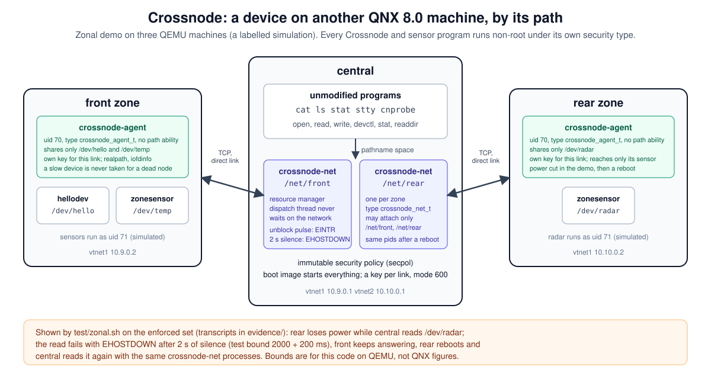

# Crossnode

Reach a device on another QNX 8.0 machine by its path, with the programs you already have.

Simulated sensors on QEMU guests (`t` is seconds since the sensor started):

```
central# ls /net/front/dev /net/rear/dev
/net/front/dev:
hello
temp

/net/rear/dev:
radar
central# cat /net/front/dev/temp /net/rear/dev/radar
cabin-temp value=22 C t=20
rear-radar value=60 cm t=20
```

QNX 7 had Qnet: every machine's `/dev` and files appeared under `/net/<node>/`, and an unmodified program could
open, read, write and devctl a device on another machine. QNX 8.0 discontinued Qnet ("Qnet code was in the io-pkt
package, which has been removed"; alternative "N/A", [QNX 8.0 discontinuation notice](https://www.qnx.com/developers/docs/relnotes8.0/com.qnx.doc.discontinuation_notice/topic/networking.html)).
Crossnode brings the path-based part back for QNX 8.0 as two small user-space programs:

- A machine shares only the paths it lists, and only root or one named group may use a peer's paths.
- Each link has its own key, and both ends prove they hold it when they connect. Frames after that are not yet
  protected (see Limits).
- When a peer goes silent, every waiting caller gets a clean error instead of hanging, and the path works again when
  the peer comes back, with nothing restarted.
- Both programs, and the simulated sensors, can run as non-root users under a QNX security policy that is enforced
  and cannot be changed while the system runs.

Crossnode has no AI component. It is infrastructure: the point is a non-obvious use of QNX's own resource manager,
message passing, boot image and security policy features to bring back something QNX 8.0 lost.



Built for the QNX Global Hackathon 2026. Each claim below points to the test run that shows it, and the limits are
listed at the end. The demo machines are QEMU guests and the sensors are simulations, not vehicle interfaces.

## Shown by tests

| What | Shown by |
|---|---|
| Unmodified programs (`cat`, `ls`, `stat`, `stty`) open, read, write and devctl a device on another machine; `stty -a` through `/net` prints the same 13 lines as on the other machine | two-node 1 to 2d, zonal 1 to 2 |
| A peer that loses power or freezes: every waiting call fails with `EHOSTDOWN` once the peer has been silent for 2 s (test bound 2000 + 200 ms), and the other zone keeps answering | zonal 9 and 10, two-node 4 and 5a |
| The peer comes back and its path works again with nothing restarted on the using machine | zonal 12 and 13, two-node 7 |
| Confined: both programs run as uid 70 and the sensors as uid 71, each under its own security type, under an immutable policy; `crossnode-net` may attach only its `/net` paths, the agent may attach none, and root cannot start another program under these types | zonal 4 to 7, boot image 6 to 11 |
| A key per link, proven at connect: an HMAC-SHA256 challenge with no key on the wire; no key, a wrong key, or an agent that cannot prove the key are refused; front's and rear's links use different keys | loopback 22a to 22f, `test/auth-vectors.c`, zonal 8 |
| Only listed paths are shared, links must stay inside a share, and only root or the group given with `-g` may use a peer | loopback 3, 3b to 3e, 12a, 12b, 19f, 20e, boot image 5 |

Every check, with what its transcript shows: [docs/EVIDENCE.md](docs/EVIDENCE.md). Transcripts are in `evidence/`;
each names the commit it ran on. The times in them are pass or fail against stated bounds for this code on
emulated machines, not performance figures for QNX.

## Where QNX is used

| QNX feature | Where | Exercised by |
|---|---|---|
| A resource manager on a pathname prefix (`resmgr_attach` with `_RESMGR_FLAG_DIR` on `/net/<name>`) | `src/cn_net.c`, `main` | zonal 1, two-node 1 |
| The dispatch thread never waits on the network: requests go to a pending table and the handler returns `_RESMGR_NOREPLY` | `src/cn_net.c`, `submit` | loopback 16a, 16b, two-node 2c-1 |
| A pulse as a doorbell from the network thread to the dispatch thread (`pulse_attach`, `MsgSendPulse`) | `src/cn_net.c`, `main`, `io_thread`, `on_doorbell` | loopback 16b |
| Replies built from the peer's answer (`MsgReply`, `MsgReplyv`, `MsgError`) | `src/cn_net.c`, `complete` | two-node 1, 2b |
| Unblock handling: a signal to a waiting client becomes an unblock pulse and the client gets `EINTR` at once (`cf.unblock`, `iof.unblock`, `resmgr_unbind`) | `src/cn_net.c`, `connect_unblock`, `io_unblock`, `cancel_waiting`, `drop_opening_ocb` | loopback 10, 14a, 14b, 21a to 21e, two-node 3, 3b |
| `stat` and `fstat`, including `stat` by name inside a combined message (`iofunc_stat_default`) | `src/cn_net.c`, `cn_stat`, `complete` | loopback 19a to 19h, two-node 2d-2 |
| Directory reads (`_IO_XTYPE_READDIR`) | `src/cn_net.c`, `cn_read`; `src/cn_agent.c`, `do_readdir` (`fdopendir`) | loopback 20a to 20h |
| Generic `devctl` forwarded by the command's direction bits | `src/cn_agent.c`, `do_devctl` | loopback 1, two-node 1 |
| Path containment (`realpath`), then the opened descriptor is asked where it points (`iofdinfo`) | `src/cn_agent.c`, `resolve`, `do_open` | loopback 3, 3b to 3e |
| A blocked device call interrupted with a targeted signal (`pthread_kill`) | `src/cn_agent.c`, `cancel_job_locked` | loopback 16d, 16e, two-node 2c-2 |
| Security policy: one type per program, recorded with `secpolgenerate`, compiled into the boot image and enforced (`on -T`, `mkqnximage --secpol --policy`) | `image/build-image.sh`, `image/record-policy.sh` | zonal 4 to 7, boot image 6 to 11 |
| A boot image that starts everything with no command typed (`mkqnximage` snippets, `waitfor`) | `image/build-image.sh` | boot image 1 to 3, zonal 1 |
| Simulated sensors as resource managers | `tools/zonesensor.c`, `tools/hellodev.c` | zonal 2, 3 |

## Why not Qnet, NFS, SSHFS or plain sockets?

| Option | What it gives | What it does not cover (by design or protocol; not a test of QNX) |
|---|---|---|
| Qnet | QNX 7's `/net/<node>/` for any resource manager | Discontinued in QNX 8.0, alternative "N/A" (notice linked above) |
| NFS v3 (QNX 8.0 has [`fs-nfs3`](https://www.qnx.com/developers/docs/8.0/com.qnx.doc.neutrino.utilities/topic/f/fs-nfs3.html) and [`nfsd`](https://www.qnx.com/developers/docs/8.0/com.qnx.doc.neutrino.utilities/topic/n/nfsd.html)) | Remote files | In the NFS v3 protocol (RFC 1813, section 3.3) there is no device-control procedure, and a device file is only a type and two numbers, so a sensor's `devctl` or `stty` has no way to reach the other machine's driver. We did not evaluate QNX's NFS. |
| SSHFS over a FUSE port | Remote files over SSH | Files only: no devices, no `devctl` |
| Plain sockets | Anything, per program | Every program needs new code; stock tools such as `cat`, `ls` and `stty` cannot use it |
| Crossnode | `open`, `read`, `write`, `devctl`, `stat` and `readdir` on a peer's listed paths, from unmodified programs | User space; the limits are below |

## Confined: non-root under an enforced security policy

With `CN_SECPOL`, `image/build-image.sh` runs both Crossnode programs as the user `crossnode` (uid 70) and the
simulated sensors as `sensor` (uid 71), each under its own security type. `CN_SECPOL=open` builds images where
`secpolgenerate` records what the running system uses; `image/record-policy.sh` boots them, runs the demo and the
checks (including a power cut and a reboot) and saves each machine's policy; `CN_SECPOL=secure` compiles that policy
into the boot image, where it is enforced and cannot be changed while the system runs. The rules were recorded from
the demo, not hand-designed or minimised. What they give the Crossnode and sensor types (`image/crossnode-types-zones.secpol`):

| Type | Runs as | May attach | May connect to | Other abilities granted |
|---|---|---|---|---|
| `crossnode_net_t` | `crossnode-net` on central, uid 70 | `/net/front` and `/net/rear` only | `io_sock_t` (the network stack), `pipe_t`, `random_t` | `nonroot`, `pathspace`, `public_channel`, `prot_exec`, `map_fixed`, `network/jailroot` |
| `crossnode_agent_t` | `crossnode-agent` on front and rear, uid 70 | nothing | its own zone's sensors (`hellodev_t`, `zonesensor_t`), `io_sock_t`, `random_t` | `nonroot`, `prot_exec`, `map_fixed`, `network/jailroot` |
| `hellodev_t`, `zonesensor_t` | the simulated sensors, uid 71 | each only its own device (`/dev/hello`, `/dev/temp`, `/dev/radar`) | nothing | `nonroot`, `pathspace`, `public_channel`, `prot_exec`, `map_fixed` |

`prot_exec` and `map_fixed` were recorded for every program here, the sensors included; we did not test removing
them.

Every ability not listed is denied.

## Zonal demo: three machines

`CN_LAYOUT=zones` adds a rear zone. Front shares a simulated cabin temperature (`/dev/temp`) and a test device
(`/dev/hello`); rear shares a simulated radar (`/dev/radar`, `tools/zonesensor.c`), whose reading moves every second.
Central reaches each zone over its own direct link and mounts both, one `crossnode-net` per zone, each with that
link's key. `image/run-zones.sh` boots the three, and `test/zonal.sh` checks the run: nothing is typed on the
machines after power-on, and the checks run commands on central over SSH from the host. Rear loses power while
central reads it; the read fails with `EHOSTDOWN` within the stated bound, front keeps answering, and when rear boots
again central reads it with the same `crossnode-net` processes. On the enforced set: 13 of 13
(`evidence/zonal-20261119T013940Z.txt`). With `CN_MUTATE=1` the same script cuts front instead of rear, leaves rear down and kills
central's services; it runs on the open (policy-recording) set, because root must be able to kill central's services there,
so checks 6 and 7 do not apply, and checks 9 to 13 fail as they should (`evidence/zonal-mutation-20261119T014026Z.txt`). `demo/zonal-demo.sh` is the
same story for the video, shown with a plain `cat` loop, which prints "Host is down".

## Reproduce

Needs QNX SDP 8.0 (the free non-commercial licence works), a Linux shell where `qnxsdp-env.sh` is sourced, and QEMU
(on macOS QEMU needs `-cpu max`, which the scripts pass). The images stay on your machine; nothing from QNX is in
this repository.

```
source ~/qnx800/qnxsdp-env.sh && make                       # build/x86_64: crossnode-net, crossnode-agent, cnprobe, hellodev, zonesensor
scripts/patch-mkqnximage.sh ~/tools                         # a copy of mkqnximage whose images accept SSH logins
ssh-keygen -t ed25519 -N '' -f ~/.ssh/cn_demo && export CN_SSH_KEY=~/.ssh/cn_demo
for r in front rear central; do CN_LAYOUT=zones CN_SECPOL=open image/build-image.sh ~/zo/$r $r ~/tools/mkqnximage ~/.ssh/cn_demo.pub; done
image/record-policy.sh ~/zo                                 # boots, runs the demo, saves ~/zo/<role>-policy.txt
for r in front rear central; do CN_LAYOUT=zones CN_SECPOL=secure CN_POLICY=~/zo/$r-policy.txt image/build-image.sh ~/zs/$r $r ~/tools/mkqnximage ~/.ssh/cn_demo.pub; done
test/zonal.sh ~/zs                                          # the zonal checks on the enforced set
demo/zonal-demo.sh ~/zs                                     # the demo
```

The pair (`front` and `central` without `CN_LAYOUT`) is built the same way and checked with `test/boot-image.sh`;
the loopback and two-node suites use two plain test machines (`test/twonode-up.sh`).

## Run by hand

On the machine that shares (here front, link address 10.9.0.2):

```
./hellodev &                                                     # optional test device at /dev/hello
./crossnode-agent -k /etc/crossnode-front.key -e /dev/hello -e /dev/ser1 -l 10.9.0.2 -p 7777 &
```

On the machine that uses it (here central):

```
./crossnode-net -k /etc/crossnode-front.key -n front -c 10.9.0.2:7777 -g 1000 &     # front appears as /net/front
cat /net/front/dev/hello
```

Both programs need `-k KEYFILE` (the same 16 or more random bytes at both ends of a link, mode 600, for example
`head -c 32 /dev/urandom > /etc/crossnode-front.key`) or, for a throwaway test, `-I` (no authentication, on both).
`crossnode-agent -e PATH` shares PATH and everything under it; `-l` and `-p` choose the listening address and port.
`crossnode-net -n NAME -c ADDRESS:PORT` mounts the peer at `/net/NAME`; `-g GID` lets that group use it besides root;
`-m DIR` changes `/net`.

## How it works

```
 program on central              central                             front
 open("/net/front/dev/hello") -> crossnode-net  --- TCP --->  crossnode-agent -> /dev/hello
                                 (resource manager on          (opens the real path,
                                  /net/front)                   one worker per request)
```

- `crossnode-net` is a resource manager on `/net/<name>`. Its handlers never wait on the network: each request goes
  to a pending table, the handler returns `_RESMGR_NOREPLY`, and an I/O thread that owns the socket rings a pulse
  when the answer arrives, so the dispatch thread replies to the waiting client.
- The I/O thread sends a liveness probe every 500 ms and declares the peer down after 2 s of silence; a connection
  attempt has 1.5 s.
- A signal to a waiting client arrives as an unblock pulse; the client gets `EINTR` at once and the peer is told to
  stop the work.
- `crossnode-agent` answers liveness probes on the connection's reader thread and runs every other request on a
  worker thread, so a slow device never looks like a dead machine. A worker's device call is interrupted with a
  signal when its caller gives up, its handle is closed or the connection ends.
- Each open is resolved with `realpath()` and must land inside a share. As a second check, the agent asks the opened
  descriptor where it really points (`iofdinfo`).

Wire format: `src/cn_proto.h` (a 28-byte header and a payload; both ends little-endian).

## Limits

- Authentication proves both ends of a link hold its key when they connect. The frames after the handshake are not
  encrypted and, for now, have no integrity or replay protection, so use a protected link.
- The handshake caps (2 waiting handshakes per address, 4 authenticated connections per address) can drop a
  legitimate handshake from an address that is also flooding.
- `crossnode-net` has one dispatch thread per process and one peer per process (central runs one per zone).
- For a directory, the second check compares device and inode of a second open, not `iofdinfo`, because `iofdinfo`
  cannot check a descriptor opened with `O_DIRECTORY` (observed: `ENOSYS`).
- A device or FIFO is checked by name before and after a second resolve, not through an opened descriptor (opening
  it would run its open handler), so a path swapped in between is narrowed but not ruled out.
- `stat` follows links, so `ls -l` shows a link inside a share as the file it points to.
- `lseek`, `pread` and `pwrite` on a file answer `ESPIPE` or `ENOSYS` rather than pretending (a directory can be
  rewound).
- No `mmap`, shared memory, or server-to-client events (`select`, `ionotify`); programs that find a server by name
  (`name_open`) rather than by path are not covered.
- The loopback and two-node suites run the services as root on plain test machines; the confined, enforced build is
  shown on the boot-image pair and the zonal set. The policy is recorded from the demo, so a use the recording did
  not see is denied until it is recorded too.
- Built and tested for x86_64 under QEMU. The base SDP has no QEMU startup for aarch64, so a mixed pair is not shown.

## Tests

```
test/twonode-up.sh IMAGES_DIR             # boot two plain test machines (nodex, nodey) with a direct link
test/gate1-loopback.sh 2222               # 69 checks on one machine
test/gate1-twonode.sh IMAGES_DIR          # 19 checks across the two machines
test/boot-image.sh PROJECTS_DIR           # the pair built by image/build-image.sh: 5 checks, 11 when confined
test/zonal.sh PROJECTS_DIR                # the three-machine zonal set: 13 checks when confined and enforced
cc -o /tmp/auth-vectors test/auth-vectors.c && /tmp/auth-vectors   # HMAC-SHA256 against RFC 4231 vectors, on the host
```

Each suite pushes or boots the current build, saves its transcript under `evidence/`, and names the commit it ran on.
All scripts that reach the machines need `CN_SSH_KEY`.

## Licence

MIT (see `LICENSE`). This repository contains no QNX files: building it needs your own QNX SDP 8.0.
